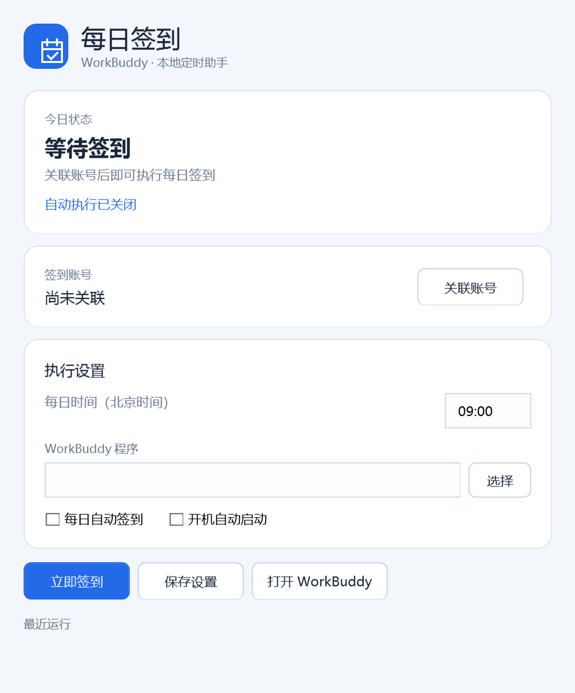

# WorkBuddy 每日签到



Windows 本地托盘助手：每天启动 WorkBuddy，执行国内版每日签到，并保存服务端确认结果。

- 原生 WPF 界面，支持高 DPI、矢量图形和多尺寸图标。
- 默认每日 09:00（北京时间），可编辑；自动执行和开机启动均默认关闭。
- 在腾讯官方网页关联本人的账号，不读取 WorkBuddy 或浏览器保存的密码。
- 登录令牌通过当前 Windows 用户的 DPAPI 加密，保存于 `%LOCALAPPDATA%\WorkBuddyDaily`。
- 每账号每天完成一次；服务端报告已签到也视为完成，不重复领取。
- 程序运行期间支持延迟启动补签、唤醒后等待网络恢复、最多三次失败尝试。
- 关闭窗口保留托盘，托盘菜单可暂停或退出。电脑关机时无法运行；选择开机启动后可在登录 Windows 后补签。

首次关联账号后，若已自动找到 WorkBuddy，会启用每日 09:00 的执行计划；当天已过该时间时会补签。开机启动仍保持关闭。时间和自动执行开关均可修改后保存，也可点击“立即签到”。

本程序不是腾讯官方产品。国内签到接口可能变化；不能确认成功时不会标记完成。目前不支持国际版活跃奖励，不自动发送对话，也不执行付费或购买操作。

## 构建与验证

Windows 10/11，.NET Framework 4.8，无第三方运行依赖。

```powershell
powershell.exe -NoProfile -ExecutionPolicy Bypass -File .\build.ps1
Start-Process .\WorkBuddyDaily.exe -ArgumentList '--self-test', "$PWD\qa\check.txt" -Wait
```

测试输出目录需预先创建。测试使用合成账号和模拟服务，不执行真实签到。首次真实登录与签到需用户完成网页授权后验证。

接口格式参考：[workbuddy-helper](https://github.com/autumnsentiment/workbuddy-helper)、[腾讯积分说明](https://www.codebuddy.cn/docs/workbuddy/Credits)。接口封装、调度和原生界面为本项目独立实现。
